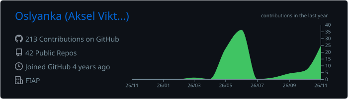
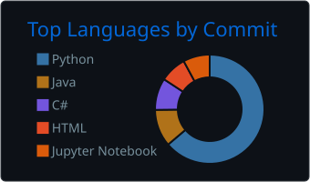

# Hello

I am <!-- age:start -->21<!-- age:end --> and graduate in December 2026. I am specially interested in FOSS, Linux and homelab/self-hosting stuff.

## stuff im working with

- frontend: React, TypeScript, JavaScript, HTML/CSS
- backend: Java, Spring Boot, C#, .NET, Python, REST, SQL, JPA, Entity Framework
- testing/automation: unit tests, API tests, GitHub Actions, UiPath
- infra (still learning): Docker, Terraform, Azure

## right now

in [Acolhe](https://acolhe-gs8.ambitiousbeach-2f5aaa39.canadacentral.azurecontainerapps.io) I did the data, RPA and DevSecOps parts with a teammate. on my own, I am writing more code by hand and trying to run my own infrastructure.

Akselviktorrae@gmail.com

## stats

