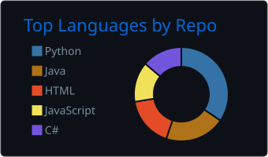
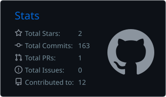
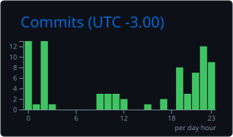

# Hello

I am a <!-- age:start -->21<!-- age:end --> y/o Software Engineering student at FIAP in São Paulo, Brazil, graduating in December 2026. I work as a front-end intern at Eurekhapag, mostly with React.

I am specially interested in FOSS, Linux and homelab/self-hosting stuff.

## stuff im working with

- frontend: React, TypeScript, JavaScript, HTML/CSS
- backend: Java, Spring Boot, C#, .NET, Python, REST, SQL, JPA, Entity Framework
- testing/automation: unit tests, API tests, GitHub Actions, UiPath
- infra (still learning): Docker, Terraform, Azure

## projects worth checking out

| project | what it is |
| --- | --- |
| [Acolhe](https://github.com/Acolhe-Projeto/Acolhe---GS8) | Portuguese/Spanish learning app, team of 4. With one teammate I did the data, RPA and DevSecOps parts. [live](https://acolhe-gs8.ambitiousbeach-2f5aaa39.canadacentral.azurecontainerapps.io) |
| [Talos](https://github.com/Oslyanka/TalosAI_assistant) | voice assistant that runs on your own machine, team of 4 (Python, Whisper, Ollama, Piper) |
| [investment services](https://github.com/Oslyanka/sprint4-aosews) | two Spring Boot services with JWT, team of 4 |
| [Future of Work API](https://github.com/Oslyanka/GlobalSolutionCS03) | .NET job-posting API with roles and JWT, team of 3 |
| [balcao-de-chamados](https://github.com/Oslyanka/balcao-de-chamados) | my Java/Spring Boot API for support tickets |
| [farol-da-rede](https://github.com/Oslyanka/farol-da-rede) | my Python/SQLite panel for checking homelab services |

## right now

writing more React by hand, and trying to get better at backend engineering, Linux, and running my own infrastructure.

## contact

[LinkedIn](https://www.linkedin.com/in/aksel-viktor-caminha/) or Akselviktorrae@gmail.com

## stats

